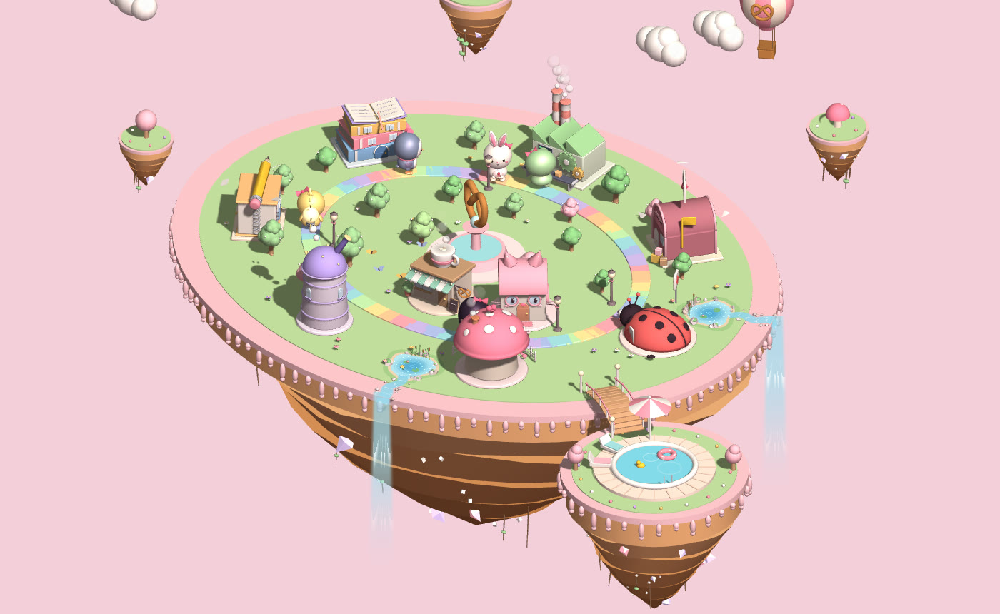
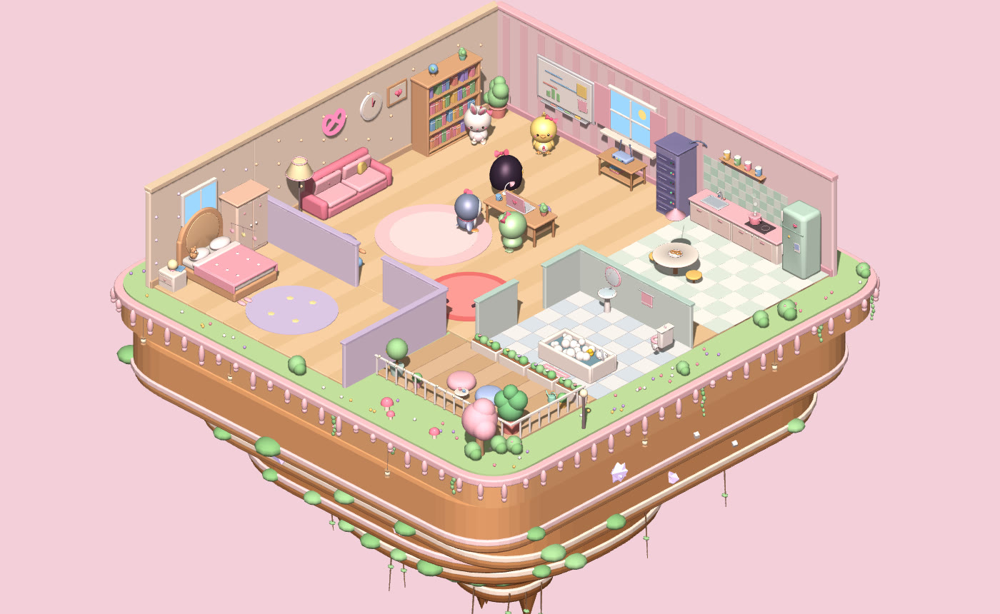

# 🥨 Miw's Town: agent town

A cozy, pastel 3D town that shows what your Claude Code agents are doing, live.

Each Claude Code session moves in as a character. It walks to the Library when it reads files, sits in the Writing Studio when it edits, and ends up at the Bug Clinic when something fails. When it's done it heads home to rest, swim or grab a pretzel.

The café game that shares these characters, Cheesecake Rush, lives in its own repo (MiwTown). `shared/` here is a copy of the characters and models from it.

## Watch your agents in the town

### Quick start

You need [Node.js](https://nodejs.org) 18+ (no `npm install`, there are no dependencies), [Claude Code](https://claude.com/claude-code) logged in on the same machine, and a browser with WebGL.

1. Run `node server.js` and open http://127.0.0.1:19100.
2. Add the hooks from `claude-settings-snippet.json` to `~/.claude/settings.json`, with `/path/to/MiwTown-agent` replaced by this folder (use the full path to `node` if hooks can't find it).
3. Start a Claude Code session anywhere. A new friend moves into town. 🎉

The hook gives up after 800 ms, so Claude Code is never slowed down when the town isn't running. Without the server, the page plays a demo with made-up agents.

### The town and the cat room

Each state an agent can be in has its own spot:

| State | Town | Cat Room |
|---|---|---|
| 💤 Resting | Cozy Cottage, pool, Pretzel Café | Sofa, kitchen, bath, bed, balcony |
| 💭 Thinking | Thinking Tower | Whiteboard |
| ✏️ Writing | Writing Studio | Desk |
| 📚 Researching | Library | Bookshelf |
| ⚙️ Running | Code Factory | Server rack |
| 📮 Syncing | Post Office | Router nook |
| 🐞 Stuck | Bug Clinic | Bug rug |

### What you can do

- **Send tasks.** ✨ New task starts a headless Claude Code run in a folder you pick, or messages an existing agent in a fork (your open window isn't touched). Tasks can only read and edit files in that folder.
- **Play with your agents.** Tap one to pet it, rename it or change its look (cat, bunny, bear, frog, chick, penguin or Miw), and see its 3D portrait, today's timeline and recent activity.
- **Get alerts.** A card pops up when a friend is stuck, waiting for you or done. The tab title counts who needs you, and 🔔 adds desktop notifications.
- **Level up.** Agents earn XP and unlock a bow, scarf, flower crown, party hat and crown (Lv 2, 3, 5, 7, 10).
- **Look around.** 🎯 Follow a friend, 📸 save a photo, and hide 🏷️ names, 💬 bubbles or 🏠 place labels. Tap any building or room to see who's there.
- **Real Bangkok time and weather.** Day and night follow Thai time, and the sky follows the real weather from [Open-Meteo](https://open-meteo.com). Try `?hour=21` or `?weather=rain` (`clear`, `cloudy`, `rain`, `storm`).
